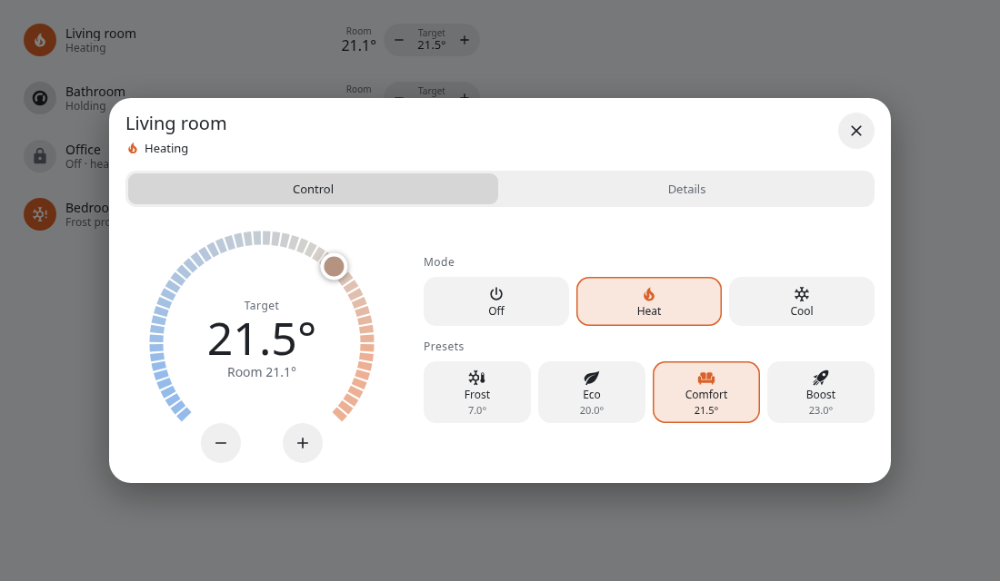
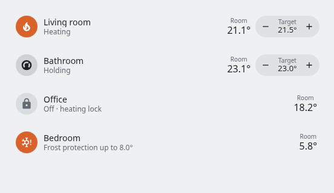
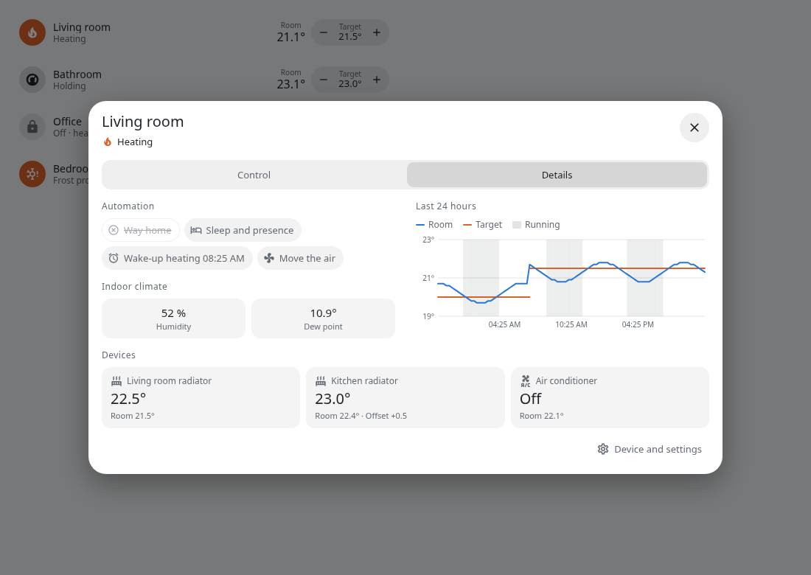
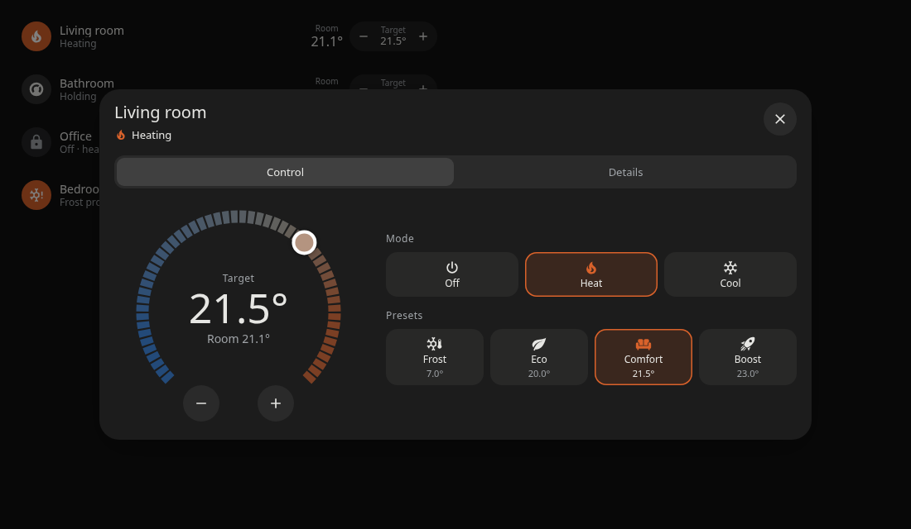
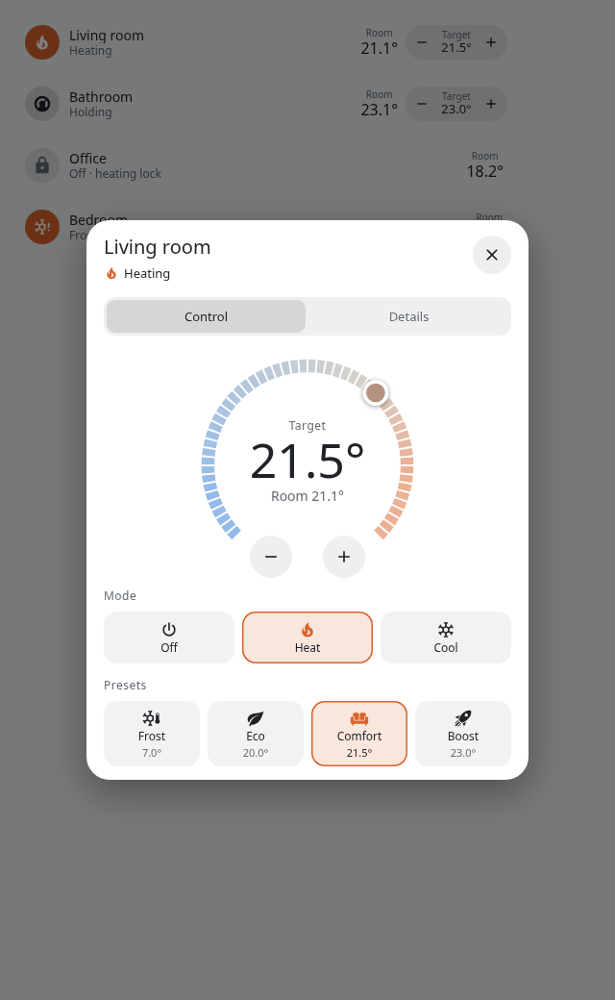

<p align="center">
  
</p>

<p align="center"><b>Room climate control for Home Assistant, based on a reference sensor of your choice.</b></p>

<p align="center"><a href="README.md">Deutsch</a> · <b>English</b></p>

ThermGenie combines the heating and cooling devices of a room into one thermostat and regulates them on a sensor
of your choice. Your existing devices stay in place: ThermGenie controls them through their `climate` entity and
corrects their setpoint until the room reaches the desired temperature.

This solves a common problem: radiator thermostats and air conditioners measure the temperature where they are
installed. It is usually warmer or colder there than in the occupied area, so the value you set never actually
reaches the room.

<p align="center">
  
</p>

The [manual](docs/en/manual.md) describes every function and routine in detail.

## Comparison with Generic Thermostat

The [Generic Thermostat](https://www.home-assistant.io/integrations/generic_thermostat/) included in Home Assistant
switches an actuator on and off based on a sensor. This is sufficient for simple heaters or fans. ThermGenie is
intended for rooms with controllable devices and more demanding requirements.

| | Generic Thermostat | ThermGenie |
| --- | --- | --- |
| **Actuator** | One switchable entity | Up to six heating devices and one air conditioner (`climate`) |
| **Control method** | Two-point control with tolerance | PI control with an approach brake, acting on the device setpoint, optionally self-optimizing |
| **Modes** | Heat or cool, fixed per instance | Off, heat and cool in one thermostat; dry and fan if the air conditioner offers them |
| **Several devices in a room** | Not intended | Offset and brake per heating device |
| **Controlled value** | Temperature | Temperature, humidex or comfort temperature |
| **Daily routine** | Presets, automations to be created separately | Sleep, absence, alarm, way home and boost built in |
| **Windows, outdoor temperature** | Separate automations | Built in, with delays and hysteresis |
| **Failure handling** | Optional shutdown on a stale sensor | Falls back to device control, failed devices do not block the others, valve verification |
| **Interface** | Standard dialog | Dedicated card and control panel |

## How it works

At a fixed interval, ThermGenie compares the reference sensor with the target and calculates a shifted setpoint for
each device. A room below the target receives a higher setpoint, a room that is too warm a lower one. Shortly before
reaching the target the controller brakes to avoid overshoot. Optionally, it learns this brake from completed heating
phases, separately per flow temperature. Commands are only sent when the value changes noticeably, which saves radio
traffic and batteries.

Each thermostat operates independently in its own mode. There is no automatic changeover between heating and
cooling.

### Optimize regulation

The controller values can be set by hand or adjusted automatically. The *Optimize regulation* selection has three levels:

| Level | Behavior |
| --- | --- |
| **Manual** | Only the values you set apply. |
| **Observe only** | Heating phases are measured, suggestions appear under *Diagnostic* and in the logbook. The regulation stays unchanged. |
| **Automatic** | kp and ki are adjusted in small steps. The values you set are kept as the basis. |

Overshoot, undershoot, swinging around the target and heat-up time are measured. A change only happens after five
comparable heating phases, based on the median, and stays between 0.5 and 2 times the values you set. Phases with an
open window, a changed target or a manual change at the device do not count. A step that makes the result worse is
taken back. Because an adjustment needs several heating phases, the optimization takes effect over days to weeks. It
only covers heating with radiators.

## Features

### Daily routine

- **Sleep and absence:** Setback to the eco preset, followed by a return to comfort
- **Heating up before waking:** Lead time ahead of an alarm, optionally a fixed time or a time from an entity
- **Way home:** Preheating based on direction and distance
- **Boost:** Raised setpoint with an optional end time
- **Windows:** Reaction to open windows with adjustable delays
- **Heat source:** With an air conditioner that can heat, choose whether to heat with the radiators, the air conditioner or both
- **Warm days:** Heating block through an outdoor sensor with hysteresis and hold time

### Air and summer operation

- **Move the air:** A fan runs while heating, while cooling or on a temperature difference between two sensors. Fans started manually are left alone.
- **Heat guard:** Starts cooling ahead of time when it is hot and someone is on the way home
- **Drying limit:** Ends drying before the air becomes too dry
- **Night cascade:** Regulates the felt temperature at the bed, first through a fan and only secondarily through the air conditioner

### Protection and monitoring

- **Heating lock:** For rooms that should not be heated. The device is closed immediately and any adjustment is set back, heating commands from outside are refused. Only frost protection suspends the lock temporarily.
- **Hold devices:** Optionally, manual changes made directly at the device are set back right away. Devices without an off mode are closed through their lowest setpoint.
- **Valve monitoring:** If a valve stays open although the heating device should close, a warning appears after an adjustable time. In a locked room, an open valve triggers the lock and leads to an alarm if the fault persists.
- **Fault tolerance:** If the reference sensor fails, the devices regulate on their own sensors. The failure of one device does not affect the others.

## Integrating with your system

Only the reference sensor and at least one device are required. Every other function becomes active once its entity
is assigned.

| Purpose | Entity | Function |
| --- | --- | --- |
| **Room temperature** (required) | `sensor` | Control reference |
| **Heating devices, air conditioner** (at least one) | `climate` | Actuators |
| Humidity | `sensor` | Humidex, dew point, comfort temperature |
| Window | `binary_sensor` | Window detection |
| Outdoor temperature | `sensor` | Heating block on warm days |
| Valve position per heating device | `sensor` | Valve monitoring, heating lock |
| Flow temperature | `sensor` | Learning the brake |
| Presence | `person`, `device_tracker`, `binary_sensor` | Setback during absence (together with sleep), way home, heat guard, night cascade |
| Sleep | `binary_sensor`, `input_boolean` | Night setback |
| Alarm, fixed time | `input_datetime`, `sensor` | Heating up before waking |
| Direction and distance | `sensor` | Way home, heat guard |
| Fan | `fan` | Move the air, night cascade |
| Notification, speech | `notify`, `media_player` | Messages and warnings |

Several ThermGenie thermostats work independently of each other, one thermostat is created per room.

### Voice control and Matter

ThermGenie provides a regular `climate` entity and can therefore be exposed through Home Assistant integrations and
Matter bridges such as Home Assistant Matter Hub. The modes available there are determined by the bridge and the
voice assistant. Expose only the `climate` entity, not the settings entities of the device.

## Interface

`thermgenie-card` shows status, room temperature and target and is automatically available in the card picker.

```yaml
type: custom:thermgenie-card
entity: climate.living_room
```

<p align="center">
  
</p>

A dedicated control panel replaces the standard dialog for all ThermGenie thermostats. It offers operation by dial,
mode and presets, as well as a details view with active automations, indoor climate, device state and the temperature
history of the last 24 hours.

<p align="center">
  
</p>
<p align="center">
  
</p>
<p align="center">
  
</p>

## Settings

All values are available as entities on the thermostat's device page and can therefore also be used in dashboards and
automations. Changes take effect immediately, and the controller keeps its state.

| Section | Content |
| --- | --- |
| **Controls** | The thermostat |
| **Sensors** | Humidex, dew point, comfort temperature |
| **Configuration** | Heat source, optimization of the regulation, regulation on real temperature, humidex or comfort temperature, preset temperatures, offset and brake per heating device, limits, times, routines. Controller parameters start disabled and can be enabled when needed. |
| **Diagnostic** | Setpoint per device, reason for a block, next heating up, sensor failure, stuck valve, learned values, optimization status |

Entity assignments and the heating lock are managed under *Configure*. The heating lock is deliberately not available
as an entity, so that it cannot be lifted through dashboards or voice assistants.

## Installation

1. Under *Settings → Marketplace*, add the repository `https://github.com/kewe87/thermgenie` as long as ThermGenie is not in the catalog yet, and install ThermGenie. Alternatively, copy `custom_components/thermgenie` to your Home Assistant directory. Then restart Home Assistant.
2. Add the integration under *Settings → Devices & services → Add integration → ThermGenie*.
3. A wizard guides you through the basic setup. All further assignments are available under *Configure*.

### Setup with AI

With an AI service (`ai_task`) set up, the menu offers *Set up with AI*. The AI suggests suitable devices, sensors and
temperatures. You review the suggestions, and they only apply once you save. The provider receives names, areas and
types of the candidate entities plus the current settings of the thermostat, but no readings or states.

## Language

The interface, card, notifications and spoken messages appear in German on a German system and in English otherwise.

## License

Copyright (c) 2026 kewe87. ThermGenie is licensed under the [GNU General Public License v3.0](LICENSE). Anyone who
distributes a modified version must provide its source code under the same license.
