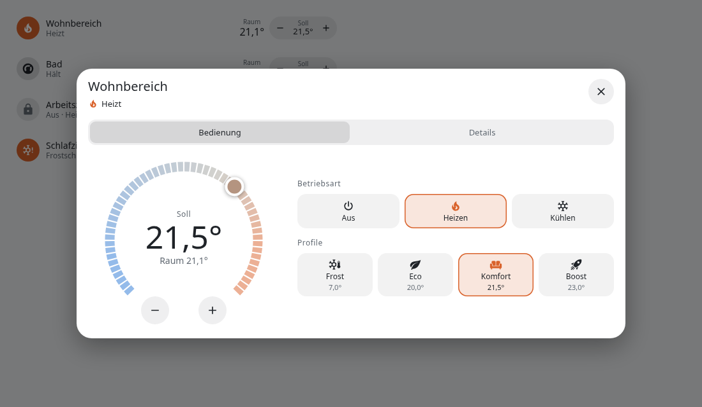
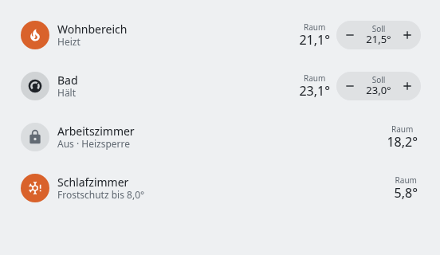
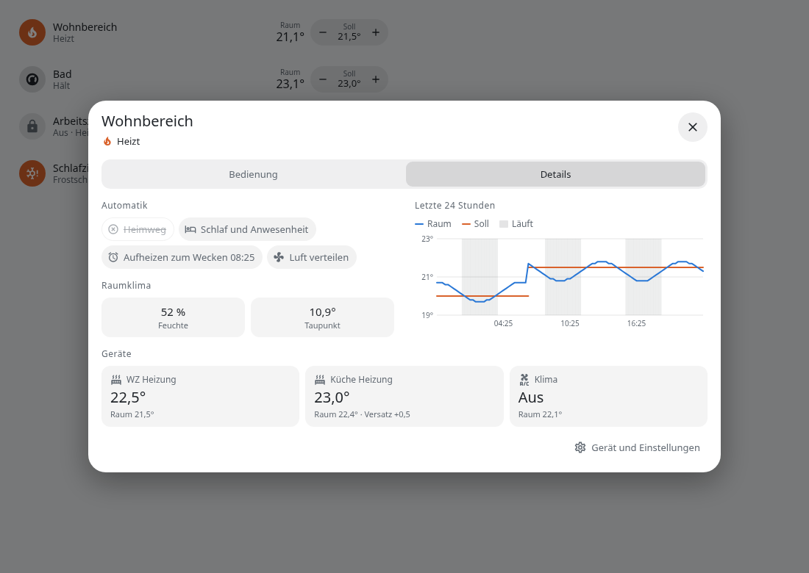
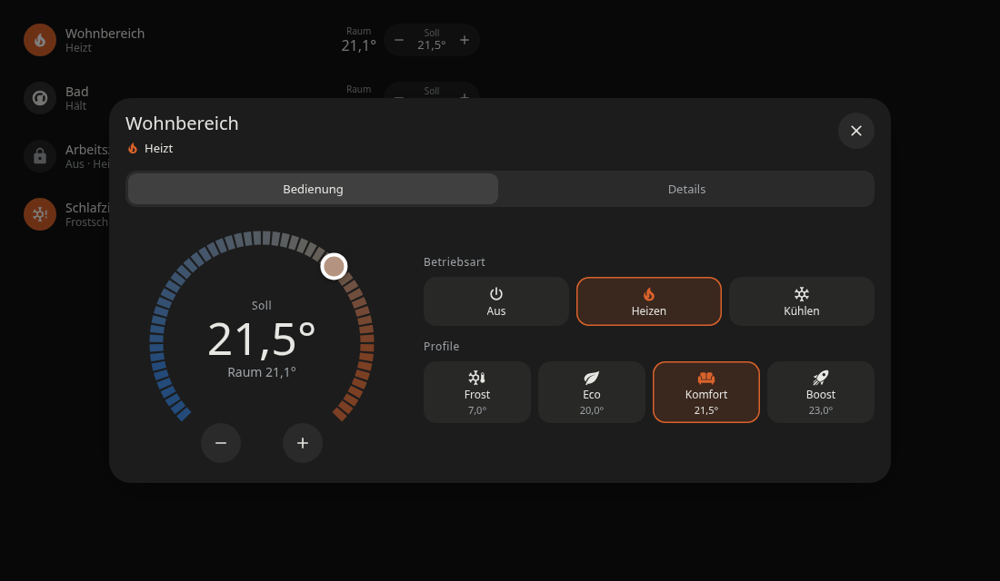
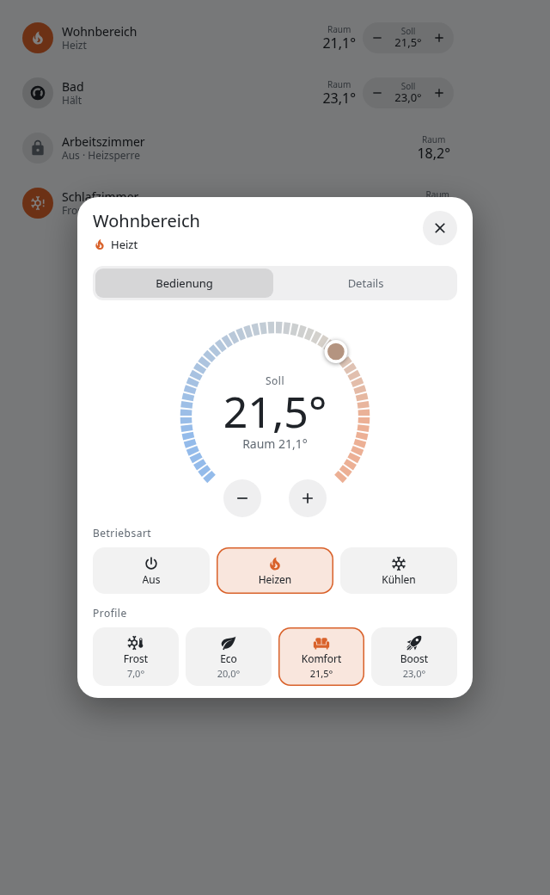

<p align="center">
  
</p>

<p align="center"><b>Raumregelung für Home Assistant auf Basis eines frei wählbaren Referenzfühlers.</b></p>

<p align="center"><b>Deutsch</b> · <a href="README.en.md">English</a></p>

ThermGenie fasst die Heiz- und Kühlgeräte eines Raums zu einem Thermostat zusammen und regelt sie auf einen
Fühler Ihrer Wahl. Die vorhandenen Geräte bleiben unverändert in Betrieb: ThermGenie steuert sie über ihre
`climate`-Entität und korrigiert ihren Sollwert so lange, bis der Raum die gewünschte Temperatur erreicht.

Das löst ein häufiges Problem: Heizkörperthermostate und Klimageräte messen die Temperatur an ihrem Einbauort.
Dort ist es meist wärmer oder kälter als im Aufenthaltsbereich, sodass der eingestellte Wert im Raum nicht
ankommt.

<p align="center">
  
</p>

Alle Funktionen und Automatiken im Detail beschreibt das [Handbuch](docs/de/handbuch.md).

## Vergleich mit dem Generic Thermostat

Das in Home Assistant enthaltene [Generic Thermostat](https://www.home-assistant.io/integrations/generic_thermostat/)
schaltet einen Aktor abhängig von einem Fühler ein und aus. Das genügt für einfache Heizgeräte oder Lüfter.
ThermGenie richtet sich an Räume mit regelbaren Geräten und weitergehenden Anforderungen.

| | Generic Thermostat | ThermGenie |
| --- | --- | --- |
| **Aktor** | Eine schaltbare Entität | Bis zu sechs Heizgeräte und ein Klimagerät (`climate`) |
| **Regelverfahren** | Zweipunktregelung mit Toleranz | PI-Regelung mit Annäherungsbremse über den Sollwert des Geräts, wahlweise selbstoptimierend |
| **Betriebsarten** | Heizen oder Kühlen, je Instanz festgelegt | Aus, Heizen und Kühlen in einem Thermostat; Trocknen und Lüfter, sofern das Klimagerät sie anbietet |
| **Mehrere Geräte im Raum** | Nicht vorgesehen | Versatz und Bremse je Heizgerät |
| **Regelgröße** | Temperatur | Temperatur, Humidex oder gefühlte Temperatur |
| **Tagesablauf** | Profile, Automationen sind separat zu erstellen | Schlaf, Abwesenheit, Wecker, Heimweg und Boost integriert |
| **Fenster, Außentemperatur** | Separate Automationen | Integriert, mit Verzögerung und Hysterese |
| **Fehlerfälle** | Optionale Abschaltung bei veraltetem Fühlerwert | Rückfall auf die Geräteregelung, ausgefallene Geräte blockieren die übrigen nicht, Prüfung der Ventile |
| **Oberfläche** | Standarddialog | Eigene Karte und eigenes Bedienfeld |

## Funktionsweise

ThermGenie vergleicht in einem festen Takt den Referenzfühler mit dem Sollwert und berechnet daraus für jedes
Gerät einen verschobenen Sollwert. Ein Raum, der unter dem Ziel liegt, erhält einen höheren Vorgabewert, ein zu
warmer Raum einen niedrigeren. Kurz vor dem Ziel bremst der Regler, um ein Überschwingen zu vermeiden. Auf Wunsch
lernt er diese Bremse aus abgeschlossenen Heizphasen, getrennt nach Vorlauftemperatur. Befehle gehen nur dann
an ein Gerät, wenn sich der Wert nennenswert ändert. Das schont den Funkkanal und die Batterien.

Jedes Thermostat arbeitet unabhängig in seiner eigenen Betriebsart. Ein automatischer Wechsel zwischen Heizen und
Kühlen findet nicht statt.

### Direktsteuerung der Ventile

Heizkörperthermostate, deren Ventilöffnung sich setzen lässt (zum Beispiel Sonoff TRVZB über Zigbee2MQTT), kann
ThermGenie direkt steuern. Statt eines verschobenen Sollwerts erhält das Ventil eine Öffnung in Prozent. Dafür lernt
ThermGenie laufend ein kleines Wärmemodell des Raums: wie stark die Heizkörper bei welcher Vorlauftemperatur heizen,
wie schnell der Raum nach außen Wärme verliert und wie träge die Heizkörper sind. Mit diesem Modell plant es die
Öffnung zwei Stunden voraus und schließt rechtzeitig, bevor der Raum überschwingt. Bis das Modell den Raum kennt,
meist nach zwei bis drei Tagen, regelt ein einfacher Regler die Ventile. Das Gelernte bleibt über Neustarts erhalten
und erscheint als Sensor *Ventilöffnung*, samt Kurve der nötigen Öffnung je Außentemperatur.

Das Thermostat behält den Sollwert als Rückfall. Fällt der Raumfühler aus, bekommt es sein Ventil zurück und regelt
selbst. Bei offenem Fenster, ausgeschalteter Heizung oder warmem Tag schließt das Ventil. Heizkörper ohne
Ventilsteuerung bleiben im Sollwert-Betrieb, beide Arten lassen sich in einem Raum mischen. Eingerichtet wird es unter
*Einstellungen → Direktsteuerung*, die Ventil-Entitäten werden am Gerät erkannt.

Nimmt das Thermostat eine Raumtemperatur von außen an (beim TRVZB *Externe Temperatur*), bekommt es zusätzlich ein
Sicherheitsnetz für den Fall, dass Home Assistant ausfällt: ThermGenie schickt ihm die Raumtemperatur, bei einer
Änderung ab 0,3 °C und sonst einmal pro Stunde, und stellt seinen Sollwert 2 °C über das Ziel. Im Alltag führt
ThermGenie das Ventil, das Thermostat schließt nur, wenn der Raum deutlich zu warm wird. Schweigt Home Assistant,
schließt es dann selbst, und nach zwei Stunden ohne neue Werte regelt es mit seinem eigenen Fühler weiter. Die seltenen
Werte kosten kaum Batterie.

### Thermal Wellbeing: nach Gefühl statt nach Zahl

**Hintergrund.** Ob ein Raum angenehm ist, hängt nur zum Teil an der Lufttemperatur. Luftfeuchte, Zugluft, die
Wärme von Wänden und Fenstern, Kleidung, Bewegung, Tageszeit und die Jahreszeit spielen mit, und jeder Mensch empfindet
anders. Die Komfortforschung beschreibt das seit Langem (etwa Fangers PMV-Modell, ISO 7730), doch ein Thermostat kennt
nur eine Zahl. Die Folge: Man stellt 21 °C ein, findet es trotzdem zu kühl und dreht auf 23 °C, oder man sieht „19 °C“
und friert, bevor man überhaupt nachgespürt hat. Thermal Wellbeing dreht das um. Es fragt nicht nach einer Zahl, sondern
danach, wie es sich anfühlt, und lernt daraus, was in diesem Raum zu welcher Zeit wirklich angenehm ist.

**Umschalten.** Jeder Raum lässt sich zwischen *Thermostat* und *Thermal Wellbeing* umschalten: mit dem Schalter unten
im Popup, mit dem Schalter *Thermal Wellbeing* auf der Geräteseite oder mit der Aktion `thermgenie.set_wellbeing`. Der
Raum springt dabei nicht, er startet dort, wo er gerade ist. In Thermal Wellbeing gibt es keine Gradzahl mehr, weder
auf der Karte noch im Popup noch in der Nachfrage per Push.

**Antworten.** Man sagt nur, wie es sich anfühlt: 🥶 kalt, 🙁 etwas kühl, 😊 passt, 😐 etwas warm, 🥵 zu warm. Das geht
über die Smileys, über Plus und Minus im Popup, über die Knöpfe einer Push-Mitteilung oder mit der Aktion
`thermgenie.feel`. Auch der Drehknopf am Thermostat ist eine Antwort: ein Stück hoch heißt etwas kühl, ein Stück runter
etwas warm, ab 1,5 Grad gedreht kalt oder zu warm. Genauso zählt ein Wert von außen, etwa von Alexa über eine Matter-Bridge: „Alexa, Wohnzimmer wärmer“ ist etwas kühl, „kälter“ etwas warm. Danach stellt ThermGenie den Knopf wieder dorthin, wo der Raum hin
soll. Hat das Thermostat eine Kindersicherung, schaltet ThermGenie sie selbst: im Thermostat-Betrieb und bei Heizsperre
an, in Thermal Wellbeing aus. Eine zweite Antwort innerhalb von zwei Minuten ersetzt die erste, etwa nach einem
Verklicken.

**Lernen.** ThermGenie merkt sich jede Antwort mit Tageszeit, Wochentag, Außentemperatur und Profil. Daraus ergibt sich
für jeden Moment, wie weit das Angenehme vom Profilwert entfernt liegt: Antworten zu ähnlicher Uhrzeit, bei ähnlichem
Wetter und im selben Profil zählen am meisten, alte Antworten verblassen. Was heute gesagt wurde, wirkt sofort und
klingt über einige Stunden ab, so dass ein einzelner fröstelnder Abend nicht die ganze Woche bestimmt. Ohne Rückmeldung
kehrt das Gelernte langsam zum Profilwert zurück. Die Profile Komfort, Eco und so weiter bleiben und lernen jeweils
mit. Auch im Thermostat-Betrieb lernt ThermGenie mit: ein von Hand verstellter Sollwert zählt als leise Rückmeldung.

**Nachfragen.** Nach einer Änderung fragt ThermGenie per Push nach, sobald der Raum etwa eine Stunde dort ist, wo die
Antwort ihn hingeschickt hat, und das so lange, bis sich die Antworten zu einer Tageszeit einpendeln. Danach fragt es
dort nicht mehr. Bei offenem Fenster fragt es nicht, und Antworten bei offenem Fenster werden zwar gespeichert, aber
nicht gelernt. Weicht eine Antwort deutlich von dem ab, was für diese Zeit schon gelernt ist, kommt eine zweite Frage:
Ist gerade etwas Besonderes? Zur Wahl stehen Besuch, Sport, krank, gerade heimgekommen, ein eigener Grund zum Eintippen oder
„ganz normal“. Mit einem besonderen Grund zählt die Antwort nicht dauerhaft, bei Besuch und krank nur für heute, und auch alle weiteren Antworten bis zum nächsten Morgen wirken, ohne gelernt zu werden. Im Popup beendet *Wieder normal* das vorher. So lernt
ThermGenie den Alltag und nicht die Ausnahmen.

**Was man sieht.** Statt einer Zahl zeigt die Karte ein Gesicht und eine Tendenz: wird wärmer, hält oder wird kühler,
auch als Sensor *Tendenz*. Das Gesicht der letzten Antwort bleibt stehen, bis der Raum dort angekommen ist oder die
Geräte nichts mehr tun können, etwa wenn ein zu warmer Raum ohne Klimagerät nur auskühlen kann. Spätestens nach zwei
Stunden ohne weitere Antwort ist es wieder neutral: Wer sich nicht mehr meldet, ist zufrieden. Unter *Details* steht in Worten, was bisher gelernt ist: für morgens, mittags, abends und
spätabends, ob es wärmer oder kühler als eingestellt sein soll, wie sicher das schon ist und wo ThermGenie nicht mehr
nachfragt. Darunter stehen die Antworten, die wegen eines besonderen Grunds nicht dauerhaft zählen.

Thermal Wellbeing funktioniert mit jeder Art von Heizkörperthermostat, mit Direktsteuerung der Ventile nur feiner.

### Regelung optimieren

Die Reglerwerte lassen sich von Hand festlegen oder automatisch anpassen. Die Auswahl *Regelung optimieren* kennt drei
Stufen:

| Stufe | Verhalten |
| --- | --- |
| **Manuell** | Es gelten ausschließlich die eingestellten Werte. |
| **Nur beobachten** | Heizphasen werden gemessen, Vorschläge erscheinen unter *Diagnose* und im Logbuch. Die Regelung bleibt unverändert. |
| **Automatisch** | kp und ki werden in kleinen Schritten angepasst. Die eingestellten Werte bleiben als Grundlage erhalten. |

Gemessen werden Überschwingen, Unterschreiten, Pendeln um das Ziel und die Aufheizdauer. Eine Änderung erfolgt erst nach
fünf vergleichbaren Heizphasen auf Basis des Medians und bleibt zwischen dem 0,5- und dem 2-Fachen der eingestellten
Werte. Phasen mit offenem Fenster, geändertem Sollwert oder manuellem Eingriff am Gerät zählen nicht. Verschlechtert ein
Schritt das Ergebnis, wird er zurückgenommen. Da eine Anpassung mehrere Heizphasen benötigt, wirkt die Optimierung über
Tage bis Wochen. Sie betrifft nur das Heizen über Heizkörper.

## Funktionen

### Alltag

- **Schlaf und Abwesenheit:** Absenkung auf das Eco-Profil, anschließend Rückkehr auf Komfort
- **Aufheizen vor dem Wecken:** Vorlauf vor einem Wecker, optional eine feste Uhrzeit oder eine Zeit aus einer Entität
- **Heimweg:** Vorheizen anhand von Richtung und Entfernung
- **Boost:** Erhöhter Sollwert mit optionaler Endzeit
- **Fenster:** Reaktion auf offene Fenster mit einstellbaren Verzögerungen
- **Heizquelle:** Bei einem heizfähigen Klimagerät lässt sich wählen, ob mit den Heizkörpern, dem Klimagerät oder beiden geheizt wird
- **Warme Tage:** Heizsperre über einen Außenfühler mit Hysterese und Haltezeit

### Luft und Sommerbetrieb

- **Luft verteilen:** Ein Ventilator läuft beim Heizen, Kühlen oder bei einem Temperaturunterschied zwischen zwei Fühlern. Manuell gestartete Ventilatoren bleiben unberührt.
- **Hitzeschutz:** Startet die Kühlung vorausschauend, wenn es heiß ist und jemand auf dem Heimweg ist
- **Entfeuchtungsgrenze:** Beendet den Trockenbetrieb, bevor die Luft zu trocken wird
- **Nachtkaskade:** Regelt die gefühlte Temperatur am Schlafplatz zuerst über einen Ventilator und nur nachrangig über das Klimagerät

### Schutz und Überwachung

- **Heizsperre:** Für Räume, die nicht beheizt werden sollen. Das Gerät wird sofort geschlossen und jede Verstellung zurückgesetzt, Heizbefehle von außen werden abgelehnt. Nur der Frostschutz setzt die Sperre vorübergehend aus.
- **Gerät halten:** Optional werden manuelle Änderungen direkt am Gerät umgehend zurückgesetzt. Geräte ohne Aus-Modus werden über ihren niedrigsten Sollwert geschlossen.
- **Ventilüberwachung:** Bleibt ein Ventil offen, obwohl das Heizgerät schließen soll, erscheint nach einer einstellbaren Zeit eine Warnung. In einem gesperrten Raum löst ein offenes Ventil die Sperre aus und führt bei anhaltendem Fehler zu einem Alarm.
- **Fehlertoleranz:** Bei Ausfall des Referenzfühlers regeln die Geräte auf ihren eigenen Fühler. Der Ausfall eines Geräts beeinträchtigt die anderen nicht.

## Integration in Ihr System

Nur Referenzfühler und mindestens ein Gerät sind erforderlich. Jede weitere Funktion wird aktiv, sobald ihre
Entität hinterlegt ist.

| Zweck | Entität | Funktion |
| --- | --- | --- |
| **Raumtemperatur** (erforderlich) | `sensor` | Referenz der Regelung |
| **Heizgeräte, Klimagerät** (mindestens eins) | `climate` | Stellglieder |
| Luftfeuchte | `sensor` | Humidex, Taupunkt, gefühlte Temperatur |
| Fenster | `binary_sensor` | Fenstererkennung |
| Außentemperatur | `sensor` | Heizsperre an warmen Tagen |
| Ventilstellung je Heizgerät | `sensor` | Ventilüberwachung, Heizsperre |
| Vorlauftemperatur | `sensor` | Lernen der Bremse |
| Anwesenheit | `person`, `device_tracker`, `binary_sensor` | Absenkung bei Abwesenheit (zusammen mit Schlaf), Heimweg, Hitzeschutz, Nachtkaskade |
| Schlaf | `binary_sensor`, `input_boolean` | Nachtabsenkung |
| Wecker, feste Uhrzeit | `input_datetime`, `sensor` | Aufheizen vor dem Wecken |
| Richtung und Entfernung | `sensor` | Heimweg, Hitzeschutz |
| Ventilator | `fan` | Luft verteilen, Nachtkaskade |
| Benachrichtigung, Sprachausgabe | `notify`, `media_player` | Meldungen und Warnungen |

Mehrere ThermGenie-Thermostate arbeiten unabhängig voneinander, je Raum wird ein Thermostat angelegt.

### Sprachsteuerung und Matter

ThermGenie stellt eine reguläre `climate`-Entität bereit und lässt sich daher über Home-Assistant-Anbindungen und
Matter-Brücken wie Home Assistant Matter Hub freigeben. Welche Betriebsarten dort verfügbar sind, bestimmen die
Brücke und der Sprachassistent. Geben Sie dabei nur die `climate`-Entität frei, nicht die Einstellungs-Entitäten des
Geräts.

## Oberfläche

Die `thermgenie-card` zeigt Status, Raumtemperatur und Sollwert und steht automatisch in der Kartenauswahl bereit.

```yaml
type: custom:thermgenie-card
entity: climate.wohnzimmer
```

<p align="center">
  
</p>

Ein eigenes Bedienfeld ersetzt den Standarddialog für alle ThermGenie-Thermostate. Es bietet die Bedienung mit
Drehregler, Betriebsart und Profilen sowie eine Detailansicht mit aktiven Automatiken, Raumklima, Gerätezustand und
Temperaturverlauf der letzten 24 Stunden.

<p align="center">
  
</p>
<p align="center">
  
</p>
<p align="center">
  
</p>

## Einstellungen

Alle Werte stehen als Entitäten auf der Geräteseite des Thermostats und lassen sich damit auch in Dashboards und
Automationen verwenden. Änderungen wirken sofort, der Regler behält dabei seinen Zustand.

| Bereich | Inhalt |
| --- | --- |
| **Steuerung** | Das Thermostat |
| **Sensoren** | Humidex, Taupunkt, gefühlte Temperatur |
| **Konfiguration** | Heizquelle, Optimierung der Regelung, Regelung nach echter Temperatur, Humidex oder gefühlter Temperatur, Profiltemperaturen, Versatz und Bremse je Heizgerät, Grenzwerte, Zeiten, Automatiken. Reglerparameter sind zunächst deaktiviert und lassen sich bei Bedarf einschalten. |
| **Diagnose** | Stellwert je Gerät, Sperrgrund, nächstes Aufheizen, Fühlerausfall, klemmendes Ventil, Lernwerte, Stand der Optimierung |

Die Zuordnung der Entitäten wird unter *Konfigurieren* vorgenommen. Die Heizsperre ist ein Schalter unter den
Einstellungen des Geräts. Wie alle Einstellungen wird er Sprachassistenten nicht von selbst freigegeben.

## Installation

1. Suchen Sie unter *Einstellungen → Marketplace* nach **ThermGenie**, installieren Sie es und starten Sie Home Assistant neu.

   Falls ThermGenie dort nicht erscheint, fügen Sie `https://github.com/kewe87/ThermGenie` als benutzerdefiniertes Repository hinzu. Ohne Marketplace kopieren Sie `custom_components/thermgenie` in Ihr Home-Assistant-Verzeichnis. Starten Sie Home Assistant in beiden Fällen anschließend neu.
2. Fügen Sie die Integration unter *Einstellungen → Geräte & Dienste → Integration hinzufügen → ThermGenie* hinzu.
3. Ein Assistent führt durch die Grundeinrichtung. Alle weiteren Zuordnungen finden Sie unter *Konfigurieren*.

### Einrichtung mit KI

Ist ein KI-Dienst (`ai_task`) eingerichtet, bietet das Menü die Option *Per KI einrichten*. Die KI schlägt passende
Geräte, Fühler und Temperaturen vor. Sie prüfen die Vorschläge, und erst das Speichern übernimmt sie. An den
Anbieter werden Namen, Bereiche und Arten der infrage kommenden Entitäten sowie die aktuellen Einstellungen des
Thermostats übermittelt, jedoch keine Messwerte oder Zustände.

## Sprache

Oberfläche, Karte, Meldungen und Sprachausgaben erscheinen auf Deutsch, wenn das System auf Deutsch eingestellt ist,
und andernfalls auf Englisch.

## Gefällt dir ThermGenie?

Dann freue ich mich über einen ⭐ auf [GitHub](https://github.com/kewe87/ThermGenie). Das hilft anderen, das Projekt zu finden. Fehler und Ideen gerne als [Issue](https://github.com/kewe87/ThermGenie/issues).

## Lizenz

Copyright (c) 2026 kewe87. ThermGenie steht unter der [GNU General Public License v3.0](LICENSE). Wer eine veränderte
Fassung weitergibt, muss deren Quellcode unter derselben Lizenz bereitstellen.
