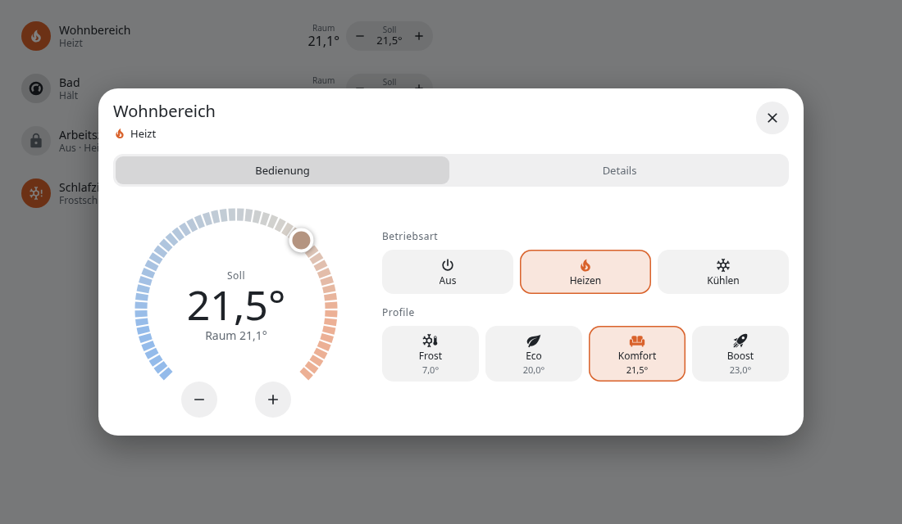
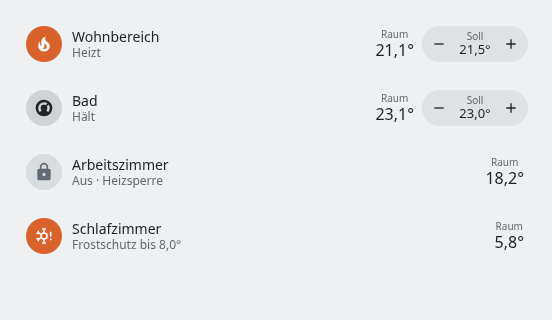
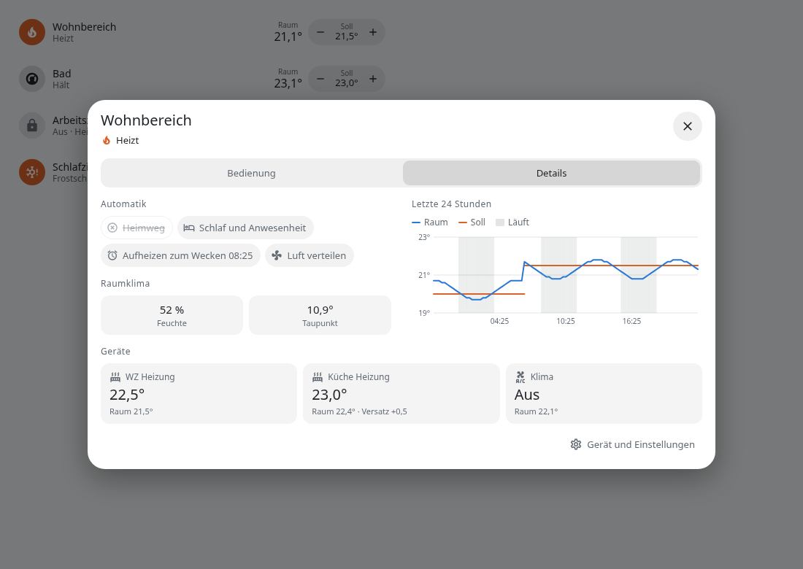
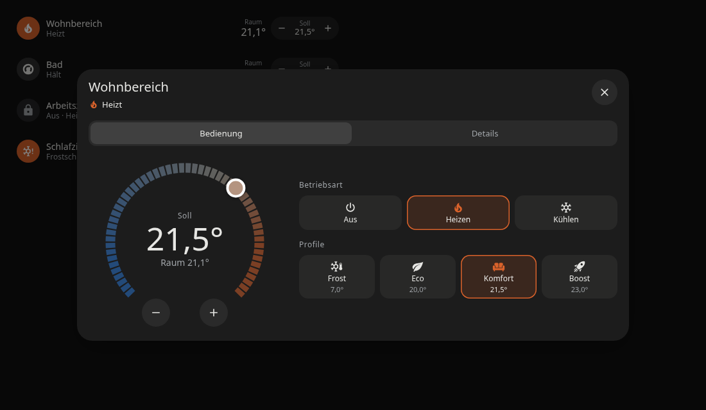
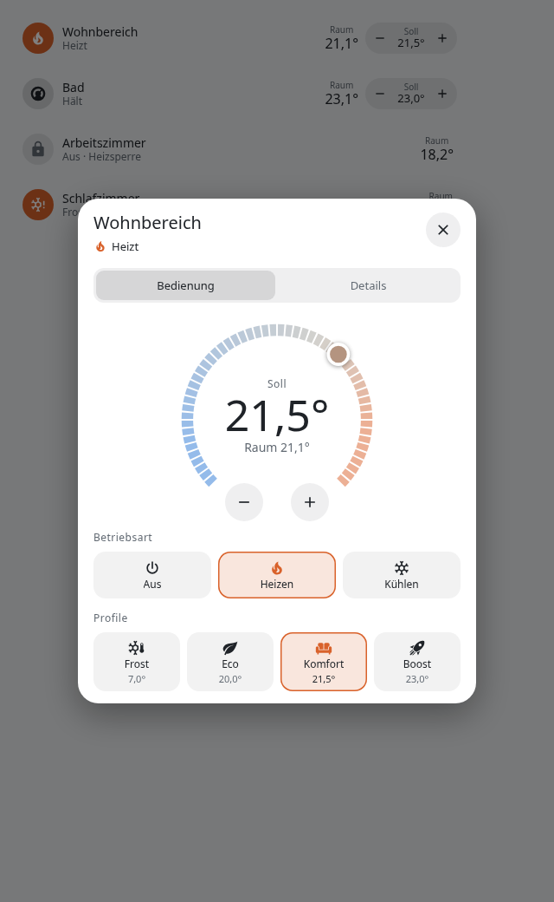

<p align="center">
  
</p>

<p align="center"><b>Raumregelung für Home Assistant auf Basis eines frei wählbaren Referenzfühlers.</b></p>

<p align="center"><b>Deutsch</b> · <a href="README.en.md">English</a></p>

ThermGenie fasst die Heiz- und Kühlgeräte eines Raums zu einem Thermostat zusammen und regelt sie auf einen
Fühler Ihrer Wahl. Die vorhandenen Geräte bleiben unverändert in Betrieb: ThermGenie steuert sie über ihre
`climate`-Entität und korrigiert ihren Sollwert so lange, bis der Raum die gewünschte Temperatur erreicht.

Das löst ein häufiges Problem: Heizkörperthermostate und Klimageräte messen die Temperatur an ihrem Einbauort.
Dort ist es meist wärmer oder kälter als im Aufenthaltsbereich, sodass der eingestellte Wert im Raum nicht
ankommt.

<p align="center">
  
</p>

Alle Funktionen und Automatiken im Detail beschreibt das [Handbuch](docs/de/handbuch.md).

## Vergleich mit dem Generic Thermostat

Das in Home Assistant enthaltene [Generic Thermostat](https://www.home-assistant.io/integrations/generic_thermostat/)
schaltet einen Aktor abhängig von einem Fühler ein und aus. Das genügt für einfache Heizgeräte oder Lüfter.
ThermGenie richtet sich an Räume mit regelbaren Geräten und weitergehenden Anforderungen.

| | Generic Thermostat | ThermGenie |
| --- | --- | --- |
| **Aktor** | Eine schaltbare Entität | Bis zu sechs Heizgeräte und ein Klimagerät (`climate`) |
| **Regelverfahren** | Zweipunktregelung mit Toleranz | PI-Regelung mit Annäherungsbremse über den Sollwert des Geräts, wahlweise selbstoptimierend |
| **Betriebsarten** | Heizen oder Kühlen, je Instanz festgelegt | Aus, Heizen und Kühlen in einem Thermostat; Trocknen und Lüfter, sofern das Klimagerät sie anbietet |
| **Mehrere Geräte im Raum** | Nicht vorgesehen | Versatz und Bremse je Heizgerät |
| **Regelgröße** | Temperatur | Temperatur, Humidex oder gefühlte Temperatur |
| **Tagesablauf** | Profile, Automationen sind separat zu erstellen | Schlaf, Abwesenheit, Wecker, Heimweg und Boost integriert |
| **Fenster, Außentemperatur** | Separate Automationen | Integriert, mit Verzögerung und Hysterese |
| **Fehlerfälle** | Optionale Abschaltung bei veraltetem Fühlerwert | Rückfall auf die Geräteregelung, ausgefallene Geräte blockieren die übrigen nicht, Prüfung der Ventile |
| **Oberfläche** | Standarddialog | Eigene Karte und eigenes Bedienfeld |

## Funktionsweise

ThermGenie vergleicht in einem festen Takt den Referenzfühler mit dem Sollwert und berechnet daraus für jedes
Gerät einen verschobenen Sollwert. Ein Raum, der unter dem Ziel liegt, erhält einen höheren Vorgabewert, ein zu
warmer Raum einen niedrigeren. Kurz vor dem Ziel bremst der Regler, um ein Überschwingen zu vermeiden. Auf Wunsch
lernt er diese Bremse aus abgeschlossenen Heizphasen, getrennt nach Vorlauftemperatur. Befehle gehen nur dann
an ein Gerät, wenn sich der Wert nennenswert ändert. Das schont den Funkkanal und die Batterien.

Jedes Thermostat arbeitet unabhängig in seiner eigenen Betriebsart. Ein automatischer Wechsel zwischen Heizen und
Kühlen findet nicht statt.

### Regelung optimieren

Die Reglerwerte lassen sich von Hand festlegen oder automatisch anpassen. Die Auswahl *Regelung optimieren* kennt drei
Stufen:

| Stufe | Verhalten |
| --- | --- |
| **Manuell** | Es gelten ausschließlich die eingestellten Werte. |
| **Nur beobachten** | Heizphasen werden gemessen, Vorschläge erscheinen unter *Diagnose* und im Logbuch. Die Regelung bleibt unverändert. |
| **Automatisch** | kp und ki werden in kleinen Schritten angepasst. Die eingestellten Werte bleiben als Grundlage erhalten. |

Gemessen werden Überschwingen, Unterschreiten, Pendeln um das Ziel und die Aufheizdauer. Eine Änderung erfolgt erst nach
fünf vergleichbaren Heizphasen auf Basis des Medians und bleibt zwischen dem 0,5- und dem 2-Fachen der eingestellten
Werte. Phasen mit offenem Fenster, geändertem Sollwert oder manuellem Eingriff am Gerät zählen nicht. Verschlechtert ein
Schritt das Ergebnis, wird er zurückgenommen. Da eine Anpassung mehrere Heizphasen benötigt, wirkt die Optimierung über
Tage bis Wochen. Sie betrifft nur das Heizen über Heizkörper.

## Funktionen

### Alltag

- **Schlaf und Abwesenheit:** Absenkung auf das Eco-Profil, anschließend Rückkehr auf Komfort
- **Aufheizen vor dem Wecken:** Vorlauf vor einem Wecker, optional eine feste Uhrzeit oder eine Zeit aus einer Entität
- **Heimweg:** Vorheizen anhand von Richtung und Entfernung
- **Boost:** Erhöhter Sollwert mit optionaler Endzeit
- **Fenster:** Reaktion auf offene Fenster mit einstellbaren Verzögerungen
- **Heizquelle:** Bei einem heizfähigen Klimagerät lässt sich wählen, ob mit den Heizkörpern, dem Klimagerät oder beiden geheizt wird
- **Warme Tage:** Heizsperre über einen Außenfühler mit Hysterese und Haltezeit

### Luft und Sommerbetrieb

- **Luft verteilen:** Ein Ventilator läuft beim Heizen, Kühlen oder bei einem Temperaturunterschied zwischen zwei Fühlern. Manuell gestartete Ventilatoren bleiben unberührt.
- **Hitzeschutz:** Startet die Kühlung vorausschauend, wenn es heiß ist und jemand auf dem Heimweg ist
- **Entfeuchtungsgrenze:** Beendet den Trockenbetrieb, bevor die Luft zu trocken wird
- **Nachtkaskade:** Regelt die gefühlte Temperatur am Schlafplatz zuerst über einen Ventilator und nur nachrangig über das Klimagerät

### Schutz und Überwachung

- **Heizsperre:** Für Räume, die nicht beheizt werden sollen. Das Gerät wird sofort geschlossen und jede Verstellung zurückgesetzt, Heizbefehle von außen werden abgelehnt. Nur der Frostschutz setzt die Sperre vorübergehend aus.
- **Gerät halten:** Optional werden manuelle Änderungen direkt am Gerät umgehend zurückgesetzt. Geräte ohne Aus-Modus werden über ihren niedrigsten Sollwert geschlossen.
- **Ventilüberwachung:** Bleibt ein Ventil offen, obwohl das Heizgerät schließen soll, erscheint nach einer einstellbaren Zeit eine Warnung. In einem gesperrten Raum löst ein offenes Ventil die Sperre aus und führt bei anhaltendem Fehler zu einem Alarm.
- **Fehlertoleranz:** Bei Ausfall des Referenzfühlers regeln die Geräte auf ihren eigenen Fühler. Der Ausfall eines Geräts beeinträchtigt die anderen nicht.

## Integration in Ihr System

Nur Referenzfühler und mindestens ein Gerät sind erforderlich. Jede weitere Funktion wird aktiv, sobald ihre
Entität hinterlegt ist.

| Zweck | Entität | Funktion |
| --- | --- | --- |
| **Raumtemperatur** (erforderlich) | `sensor` | Referenz der Regelung |
| **Heizgeräte, Klimagerät** (mindestens eins) | `climate` | Stellglieder |
| Luftfeuchte | `sensor` | Humidex, Taupunkt, gefühlte Temperatur |
| Fenster | `binary_sensor` | Fenstererkennung |
| Außentemperatur | `sensor` | Heizsperre an warmen Tagen |
| Ventilstellung je Heizgerät | `sensor` | Ventilüberwachung, Heizsperre |
| Vorlauftemperatur | `sensor` | Lernen der Bremse |
| Anwesenheit | `person`, `device_tracker`, `binary_sensor` | Absenkung bei Abwesenheit (zusammen mit Schlaf), Heimweg, Hitzeschutz, Nachtkaskade |
| Schlaf | `binary_sensor`, `input_boolean` | Nachtabsenkung |
| Wecker, feste Uhrzeit | `input_datetime`, `sensor` | Aufheizen vor dem Wecken |
| Richtung und Entfernung | `sensor` | Heimweg, Hitzeschutz |
| Ventilator | `fan` | Luft verteilen, Nachtkaskade |
| Benachrichtigung, Sprachausgabe | `notify`, `media_player` | Meldungen und Warnungen |

Mehrere ThermGenie-Thermostate arbeiten unabhängig voneinander, je Raum wird ein Thermostat angelegt.

### Sprachsteuerung und Matter

ThermGenie stellt eine reguläre `climate`-Entität bereit und lässt sich daher über Home-Assistant-Anbindungen und
Matter-Brücken wie Home Assistant Matter Hub freigeben. Welche Betriebsarten dort verfügbar sind, bestimmen die
Brücke und der Sprachassistent. Geben Sie dabei nur die `climate`-Entität frei, nicht die Einstellungs-Entitäten des
Geräts.

## Oberfläche

Die `thermgenie-card` zeigt Status, Raumtemperatur und Sollwert und steht automatisch in der Kartenauswahl bereit.

```yaml
type: custom:thermgenie-card
entity: climate.wohnzimmer
```

<p align="center">
  
</p>

Ein eigenes Bedienfeld ersetzt den Standarddialog für alle ThermGenie-Thermostate. Es bietet die Bedienung mit
Drehregler, Betriebsart und Profilen sowie eine Detailansicht mit aktiven Automatiken, Raumklima, Gerätezustand und
Temperaturverlauf der letzten 24 Stunden.

<p align="center">
  
</p>
<p align="center">
  
</p>
<p align="center">
  
</p>

## Einstellungen

Alle Werte stehen als Entitäten auf der Geräteseite des Thermostats und lassen sich damit auch in Dashboards und
Automationen verwenden. Änderungen wirken sofort, der Regler behält dabei seinen Zustand.

| Bereich | Inhalt |
| --- | --- |
| **Steuerung** | Das Thermostat |
| **Sensoren** | Humidex, Taupunkt, gefühlte Temperatur |
| **Konfiguration** | Heizquelle, Optimierung der Regelung, Regelung nach echter Temperatur, Humidex oder gefühlter Temperatur, Profiltemperaturen, Versatz und Bremse je Heizgerät, Grenzwerte, Zeiten, Automatiken. Reglerparameter sind zunächst deaktiviert und lassen sich bei Bedarf einschalten. |
| **Diagnose** | Stellwert je Gerät, Sperrgrund, nächstes Aufheizen, Fühlerausfall, klemmendes Ventil, Lernwerte, Stand der Optimierung |

Die Zuordnung der Entitäten und die Heizsperre werden unter *Konfigurieren* vorgenommen. Die Heizsperre ist bewusst
nicht als Entität verfügbar, damit sie sich nicht über Dashboards oder Sprachassistenten aufheben lässt.

## Installation

1. Fügen Sie unter *Einstellungen → Marketplace* das Repository `https://github.com/kewe87/thermgenie` hinzu, solange ThermGenie noch nicht im Katalog steht, und installieren Sie ThermGenie. Alternativ kopieren Sie `custom_components/thermgenie` in Ihr Home-Assistant-Verzeichnis. Starten Sie Home Assistant anschließend neu.
2. Fügen Sie die Integration unter *Einstellungen → Geräte & Dienste → Integration hinzufügen → ThermGenie* hinzu.
3. Ein Assistent führt durch die Grundeinrichtung. Alle weiteren Zuordnungen finden Sie unter *Konfigurieren*.

### Einrichtung mit KI

Ist ein KI-Dienst (`ai_task`) eingerichtet, bietet das Menü die Option *Per KI einrichten*. Die KI schlägt passende
Geräte, Fühler und Temperaturen vor. Sie prüfen die Vorschläge, und erst das Speichern übernimmt sie. An den
Anbieter werden Namen, Bereiche und Arten der infrage kommenden Entitäten sowie die aktuellen Einstellungen des
Thermostats übermittelt, jedoch keine Messwerte oder Zustände.

## Sprache

Oberfläche, Karte, Meldungen und Sprachausgaben erscheinen auf Deutsch, wenn das System auf Deutsch eingestellt ist,
und andernfalls auf Englisch.

## Lizenz

Copyright (c) 2026 kewe87. ThermGenie steht unter der [GNU General Public License v3.0](LICENSE). Wer eine veränderte
Fassung weitergibt, muss deren Quellcode unter derselben Lizenz bereitstellen.
